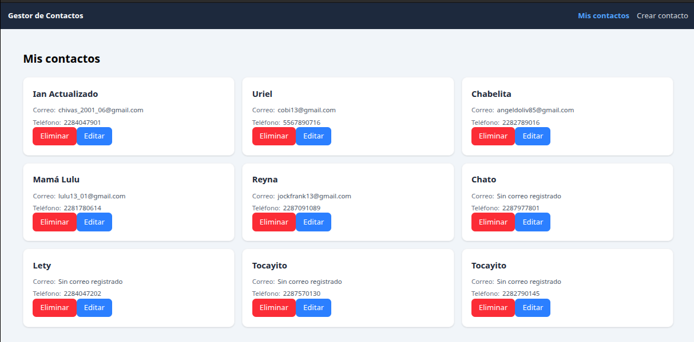
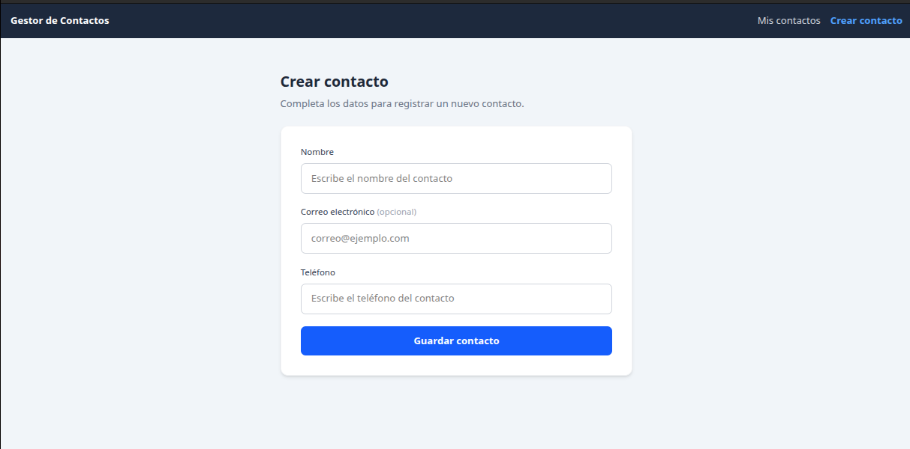
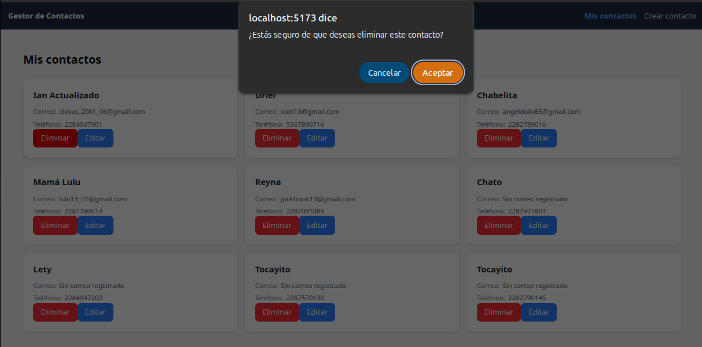
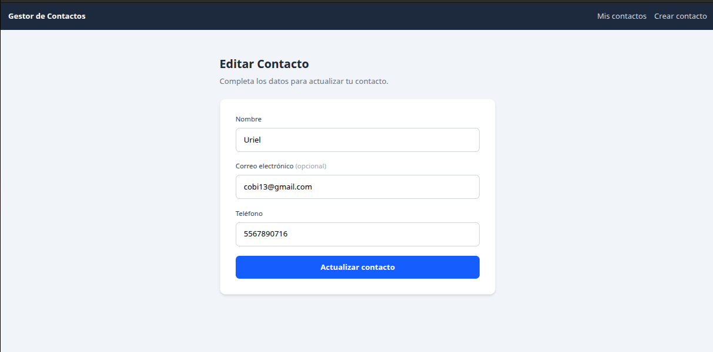
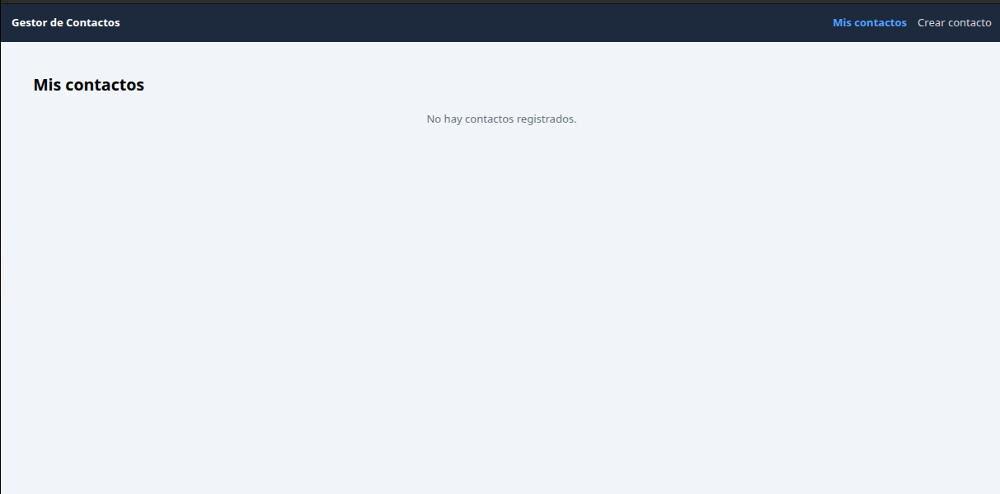
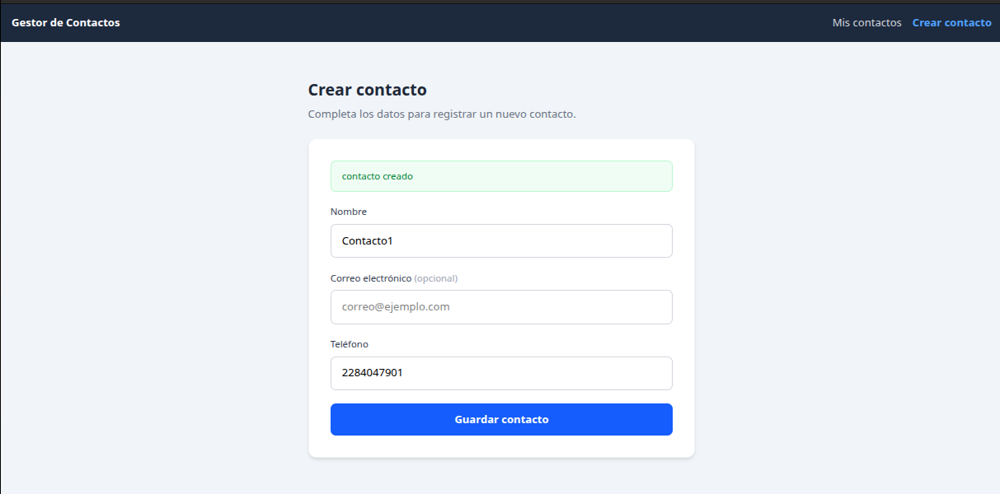
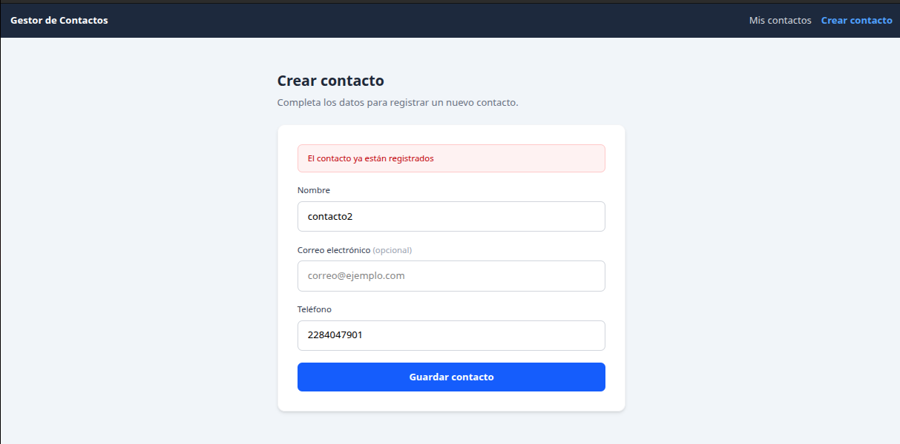
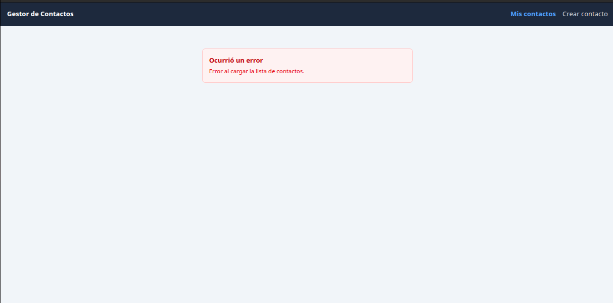

# Mini proyecto personal Lista de contactos, backend y frontend integrado

    En este apartado tendran imagenes ilustrativas de lo que es el mini proyecto del lado frontend

### carga de contactos

### formulario de creacion de contacto

### mensaje de confirmacion para eliminar un contacto

### muestra del formulario de edicion de contacto

### muestra de contactos cuando no existe uno solo

### manejo de casos en la creacion de contactos

### manejo de estado cuando el backend no responde

